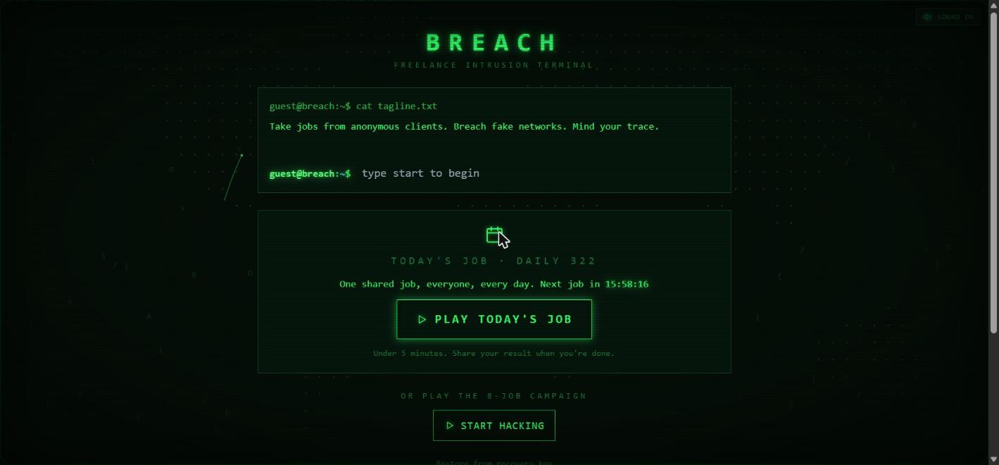
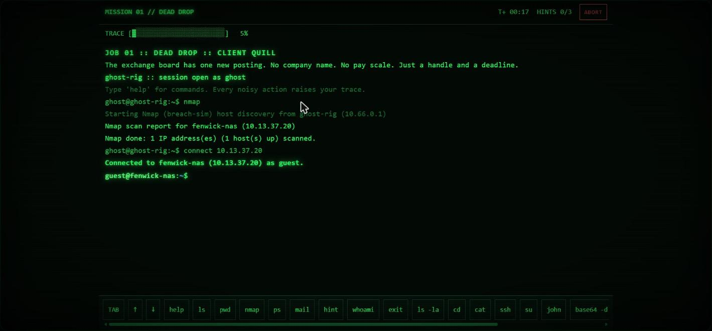
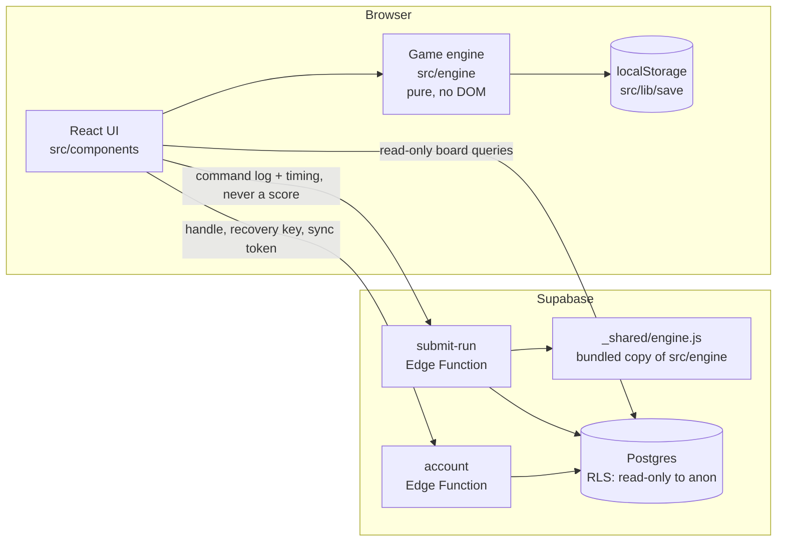

# BREACH

A browser hacking terminal game. Take freelance jobs from anonymous clients, breach fake networks built for the
mission, and learn real security ideas — weak passwords, bad hashes, SQL injection, social engineering — by doing
them. Nothing here touches a real system, and the leaderboard can't be faked because the browser never gets to
grade its own run.

**Play it: [breachgame.xyz](https://breachgame.xyz)**




## Features

- **Kali-style terminal** — a real shell: tab completion, command history, piping, aliases, password prompts that
  don't echo, the works.
- **Three difficulty tiers** — Easy, Medium and Hard change trace speed, hint limits, decoys and (on Hard) a clock.
  The solution never changes, only how forgiving the run is.
- **8-job story campaign** — a continuing plot across QUILL's postings, playable on any tier, any number of times.
- **Daily challenge** — one procedurally generated job, the same for everyone, every day, under five minutes. Every
  Friday it's the harder **Hard Friday** variant: no hints, faster trace, every decoy live, its own badge and its
  own leaderboard (dailies are already scoped per calendar day).
- **Real-world security debriefs** — every job and every daily ends with what the mistake actually is, in the field.
- **Achievements**, a **profile**, and an **Ops Log** that replays any past attempt command-by-command, at the
  engine's own speed, so you can watch exactly what happened.
- **Cloud save with a recovery key** — progress follows you across devices without an email or a password; the key
  is shown once and the server only ever stores a hash of it.

## How the anti-cheat works

The browser **never sends a score**. When you finish a run, the client sends the one thing it actually knows for
certain: the commands you typed, and when. A Supabase Edge Function takes that log and replays it, command by
command, through the exact same deterministic engine that ran in your browser — same mission, same tier, same
rules — and computes the score itself, from the replay, from scratch. If the replay doesn't reach a `submit` with
the right flag, or the timing between commands is faster than a person can plausibly type (checked against a
minimum gap and a minimum average pace), the run is rejected outright. If a client sends a claimed score anyway,
the server only accepts it when it matches the replay exactly.

That validator (`src/engine/replay.ts`) is pure: no DOM, no storage, no network. It's the same module the game
itself uses to drive a mission, bundled into the Edge Function by `scripts/build-edge.mjs` and tested in
`tests/replay.test.ts` and `tests/missions.test.ts`, which play every mission's real solution through it. The
server trusts its own replay, never the client's word.

## Tech stack

- **Next.js** (App Router, static export) + **TypeScript**, styled with **Tailwind**
- **Vitest** for the engine, mission and UI-logic tests
- **Supabase**: Postgres (read-only to the browser via RLS) + Edge Functions (Deno) for every write
- **Web Audio API**: real recordings for keystrokes and every discrete sound effect; a small generative music
  engine for the soundtrack's alternate tracks and its trace-driven tension layer (see `assets/audio/LICENSES.md`)

## Architecture



The engine is the one piece of logic that has to behave identically in two places — the browser and the Edge
Function — so it's the same source, not a reimplementation: `scripts/build-edge.mjs` bundles `src/engine` into
`supabase/functions/_shared/engine.js` as part of `npm run build`, and `tests/origins.test.ts` /
`tests/replay.test.ts` cover the pieces both sides share (CORS origin matching, the replay validator).

## Project structure

```
src/app/            Next shell: layout, page, globals.css, robots.ts/sitemap.ts, crash screens
src/components/     React UI. Reads session state, never mutates game rules.
src/lib/            save, audio, music, themes, progress, site, analytics, origins, feedback, leaderboard, cloud...
src/engine/         Pure game logic (no React, no DOM, no storage): session, commands, fs, sql, encoding, scoring
src/missions/       Mission data: one file per campaign job, plus the daily generator's shared pieces
supabase/
  functions/        account and submit-run Edge Functions, plus the bundled shared engine
  migrations/       Postgres schema: players, runs, rate_limits, RLS policies
tests/              missions.test.ts (plays every mission), engine.test.ts, replay.test.ts, and the rest
scripts/            build-edge.mjs (bundles the engine), build-audio.mjs (builds public/audio/ from raw recordings)
assets/audio/       LICENSES.md — every audio file's source, author and license
```

## Running it locally

```bash
npm install
npm run dev       # http://localhost:3000
```

Cloud save and the leaderboard are optional: without `NEXT_PUBLIC_SUPABASE_URL` and
`NEXT_PUBLIC_SUPABASE_PUBLISHABLE_KEY` set (copy `.env.example` to `.env.local`), the game runs entirely offline —
progress just stays on the device.

## Tests

```bash
npm test     # vitest run — 477 tests across 16 files
npm run build  # type-checks and writes the static site to out/
```

`tests/missions.test.ts` plays every campaign job's and every generated daily's real solution end to end, on every
tier, and checks it's beatable, rejects a wrong flag, and has a rig, three hints and valid neighbour IPs.

## Security

- **Read-only database.** Row-level security grants `select` on `players` and `runs` to anonymous and authenticated
  roles and nothing else — no insert, update or delete policy exists for them. `rate_limits` has RLS on with no
  policies at all: nothing but the service role can see it.
- **Every write goes through an Edge Function**, using the service-role key, which never reaches the browser.
- **Recovery keys are never stored in readable form.** They're hashed with HMAC under a server-side pepper
  (`RECOVERY_PEPPER`, an environment variable, never in source); sync tokens are stored as a SHA-256 hash.
- **Rate limiting** on submissions, account restores (per caller and globally) and sync, enforced server-side in
  Postgres, independent of anything the client claims.
- **An origin allow-list** (`src/lib/origins.ts`, shared with the Edge Functions) gates CORS: only the game's own
  hosts get `access-control-allow-origin` back.
- Found a way around any of this? **breachgame.contact@gmail.com** — leaderboard exploits are genuinely welcome to
  report.

## Credits

Built with [Next.js](https://nextjs.org/) and [Supabase](https://supabase.com/). Interface sounds by
[Kenney](https://kenney.nl/) (CC0). Keyboard, alarm, modem and ambience recordings from Freesound contributors
stu556, za-games, wtermini, alphatone, rhinenux, soundandmelodies and music_is_wiggly_air (CC0). Soundtrack
"Cyberpunk Drone" by Leberche (Pixabay Content License). Full list with links in
[`assets/audio/LICENSES.md`](assets/audio/LICENSES.md).

## License

Code is [MIT](LICENSE). Audio assets keep their own licenses — see
[`assets/audio/LICENSES.md`](assets/audio/LICENSES.md).

---

Built by [Sagesh Adhikari](https://github.com/ctrl-sagesh).
